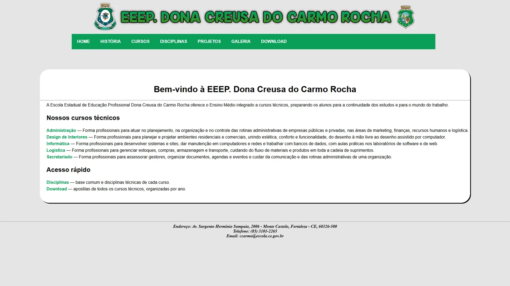
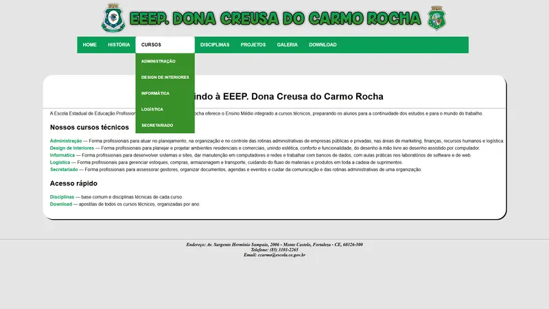
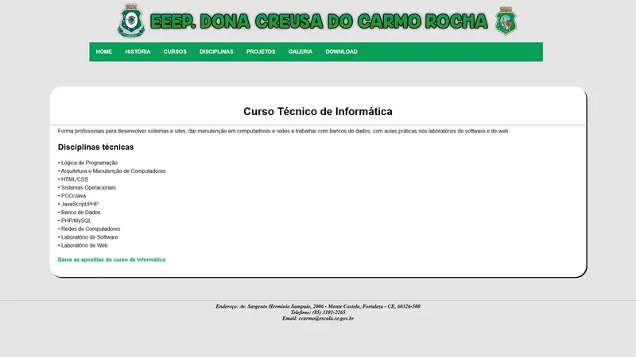
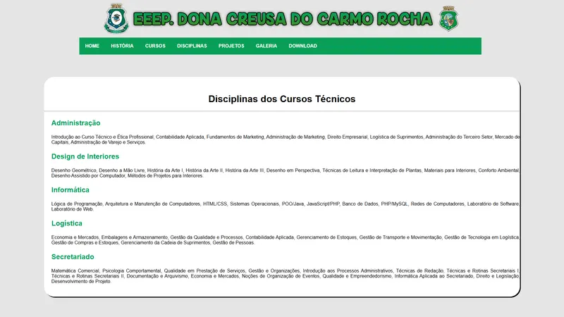
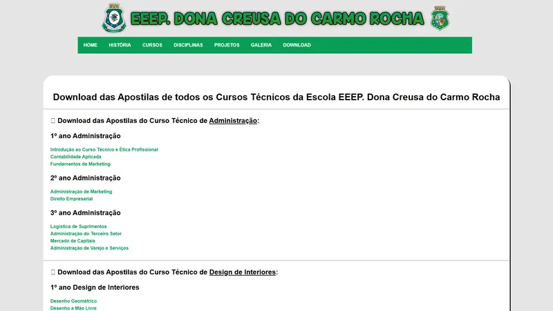
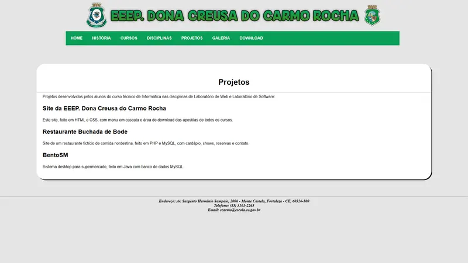

# Site da EEEP Dona Creusa do Carmo Rocha

Meu primeiro site: cursos, disciplinas e download das apostilas da escola técnica.

<p align="center">
  
</p>

---

## Sumário

- [Visão geral](#visão-geral)
- [Telas](#telas)
- [Stack e versões](#stack-e-versões)
- [Estrutura do projeto](#estrutura-do-projeto)
- [Primeiros passos](#primeiros-passos)
- [Revisão para o portfólio](#revisão-para-o-portfólio)
- [Autor](#autor)

---

## Visão geral

Site institucional da escola técnica onde estudei, feito em 2016 com HTML e CSS puros. Tem menu em cascata, páginas dos cinco cursos técnicos (Administração, Design de Interiores, Informática, Logística e Secretariado) com as disciplinas de cada um e uma área de download com as apostilas de todos os cursos, organizadas por ano. As páginas que estavam vazias foram completadas com o conteúdo de cursos e disciplinas planejado na época.

Principais funcionalidades:

- Menu em cascata só com CSS
- Páginas dos cinco cursos técnicos
- Download de 58 apostilas por curso e ano

Projeto do Ensino Médio Técnico em Informática (2016).

---

## Telas


<table>
  <tr>
    <td width="50%"><br><sub>Menu em cascata dos cursos</sub></td>
    <td width="50%"><br><sub>Página do curso técnico de Informática</sub></td>
  </tr>
  <tr>
    <td width="50%"><br><sub>Disciplinas dos cursos técnicos</sub></td>
    <td width="50%"><br><sub>Download das apostilas</sub></td>
  </tr>
  <tr>
    <td width="50%"><br><sub>Projetos dos alunos</sub></td>
  </tr>
</table>

---

## Stack e versões

| Categoria | Tecnologia | Versão |
| --- | --- | --- |
| Linguagem | HTML5 + CSS3 | — |
| Menu | Menu em cascata só com CSS | — |

---

## Estrutura do projeto

```
index.html        Página inicial
historia.html     História da escola
cursos.html       Cursos técnicos (+ uma página por curso)
disciplinas.html  Base comum e disciplinas técnicas
download.html     Apostilas de todos os cursos, por ano
CSS/layout.css    Estilos
DOWNLOAD/         Apostilas em PDF
IMG/              Cabeçalho e ícone
```

---

## Primeiros passos

### Pré-requisitos

- Qualquer navegador (não precisa de servidor)

### Instalação

Basta abrir o `index.html` no navegador. Também dá para servir a pasta com qualquer servidor estático.

---

## Revisão para o portfólio

As páginas que tinham ficado vazias foram completadas com o conteúdo de cursos e disciplinas planejado na época, os arquivos passaram para UTF-8 e o item "Galeria" do menu passou a apontar para a página de fotos. O layout e o estilo originais foram mantidos.

---

## Autor

**Marcos Paulo** · Desenvolvedor Full-Stack

- LinkedIn: [in/marcospsdev](https://www.linkedin.com/in/marcospsdev)
- GitHub: [@marcospsdev](https://github.com/marcospsdev)
